<p align="center">
  
</p>

<h1 align="center">quietframe</h1>

<p align="center">
  <b>Noise-adaptive video denoising for Log camera footage, calibrated per Log profile.</b><br>
  Fix noisy high-ISO Canon Log 2 / Canon Log 3 clips with ffmpeg <code>hqdn3d</code>, applied after your Log → Rec.709 LUT. No machine learning, no GPU, no dependencies.
</p>

<p align="center">
  <a href="https://github.com/ludodelot/quietframe/actions/workflows/ci.yml"></a>
  
  
  
  
</p>

---

## What is quietframe?

**quietframe** is a small command-line tool and [Claude Code](https://claude.com/claude-code) skill that **removes noise from Log footage** (Canon Log 2, Canon Log 3, shot on a Canon EOS R6 V) in the Rec.709 image your LUT produces.

Log footage shot at high ISO gets its shadow noise amplified by the display transform. How much noise a clip has depends on the scene and on the Log curve, not only on the ISO, so quietframe measures each clip, picks a denoise strength from a calibration made for that Log profile, and applies it after your LUT.

It is built for anyone searching for how to **denoise Log footage**, **reduce noise in high-ISO video after a LUT**, **calibrate noise reduction per Log curve** or **automate ffmpeg denoising per clip**.

- **Measures each clip.** Strength comes from the noise measured in the clip, not from the ISO alone.
- **Denoises after your LUT.** `--lut my.cube` is applied first, then the denoise. `--stage before` flips the order.
- **Safe by default.** Never modifies originals, refuses to overwrite its input or an existing output.
- **Honest.** Anything not validated is flagged `[untested tier]`.
- **Zero dependencies.** Python stdlib and `ffmpeg`. `numpy` is optional (noise measurement), `exiftool` is optional (ISO fallback).

## Where to denoise: after the LUT

<p align="center"></p>

I expected denoising the Log frames first to win, and the first version of this tool did that. Measured properly (correct LUT for each Log curve, same strengths, 4 frames per point), it does not: at the same residual noise, denoising **after** the LUT kept the same or more detail on all three clips, most clearly in Canon Log 3. So that is the default, and `--stage before` is there if you prefer the other order.

Residual noise / detail kept, relative to LUT only (100% / 100%), for strengths 1.5, 2, 3, 4:

| Clip | Stage | 1.5 | 2 | 3 | 4 |
|---|---|---|---|---|---|
| Canon Log 2, ISO 6400 | after | 70 / 98 | 59 / 97 | 44 / 96 | 36 / 94 |
| | before | 63 / 97 | 54 / 96 | 46 / 94 | 43 / 92 |
| Canon Log 2, ISO 51200 | after | 87 / 99 | 79 / 99 | 65 / 98 | 55 / 96 |
| | before | 78 / 99 | 68 / 98 | 55 / 95 | 46 / 93 |
| Canon Log 3, ISO 8299 | after | 76 / 99 | 68 / 98 | 56 / 96 | 47 / 94 |
| | before | 62 / 96 | 55 / 94 | 49 / 91 | 45 / 87 |

Three clips is a small sample; it is a measured tendency, not a law. Noise is the Haar-band estimate on the final image; detail is the 95th percentile of block high-pass energy.

## Quick start

Requires `ffmpeg`. Optional: `numpy` (measure noise), `exiftool` (read ISO for the fallback).

```bash
pip install git+https://github.com/ludodelot/quietframe
```

```bash
python -m quietframe filter clip.mp4                 # measures noise, prints the -vf chain
python -m quietframe filter clip.mp4 --mode iso      # ISO table only (no numpy needed)
python -m quietframe filter clip.mp4 --lut my.cube   # your LUT first, then the denoise
python -m quietframe run clip.mp4 -o clean.mov --iso 6400 --preset strong
```

Presets: `light`, `normal` (default), `strong`. `--stage before` denoises before the LUT instead. `--range full` (default) tags the source full range, correct for Canon Log from the R6 V. Use `--range auto` otherwise.

## How it works

<p align="center"></p>

1. **Read** the Log profile from the `.CPF` sidecar next to the clip (`--log-profile auto`). It is never guessed; an unknown profile is flagged `[untested tier]`.
2. **Measure** noise on 5 full frames and take the median (truncated-RMS of the Haar diagonal band).
3. **Choose strength** from the measured noise with per-profile anchors. Spatial strength is clamped to 4.0.
4. **Filter** with `hqdn3d` after your LUT (`--stage before` to reverse).
5. **Render** to a new file. Without `numpy`, an ISO table is used instead.

### Why measure the clip instead of trusting the ISO, and why per Log profile

<p align="center"></p>

Noise measured in the Log domain on 356 real Canon EOS R6 V clips (160 in Canon Log 2, 196 in Canon Log 3):

| Profile | Clips | Base ISO ≤ 1000 (median, n) | ISO ≥ 5500 (median, n) |
|---|---|---|---|
| Canon Log 2 | 160 | 0.00076 (75) | 0.00140 (19) |
| Canon Log 3 | 196 | 0.00082 (91) | 0.00106 (19) |

Noise rises with ISO in Log 2 and barely in Log 3, and at the same ISO two clips can differ by about 2× (10th to 90th percentile at base ISO: 0.0005 to 0.0011 in Log 2). Per-frame spread is about 20% and per-region about 25%, so the estimator uses 5 full frames and takes the median. Treat the estimate as ±30%. The full summary is in [`assets/calibration_summary.json`](assets/calibration_summary.json) (aggregates only).

Strength is clamped to a spatial value of 1.0 to 4.0. The cap is deliberately conservative: at the highest ISOs it leaves part of the noise (about 55% after the LUT at ISO 51200) rather than trade away detail.

## Use it as a Claude Code skill

<p align="center"></p>

Copy [`skill/SKILL.md`](skill/SKILL.md) into your Claude Code skills folder, then ask:

> *"My clips look grainy, denoise them before I grade."*

Claude finds the Log profile from the `.CPF` sidecar, builds the filter chain, tests a crop before a batch, and reports any `[untested tier]` instead of calling it proven.

To calibrate another camera: `python -m quietframe calibrate @clips.txt -o noise.csv` (never publish the `path` column).

## Status

v1.0, classical (ffmpeg `hqdn3d`). Strength comes from the noise measured in the clip (needs numpy); without numpy it falls back to an ISO table.

Validation with the default settings (denoise after the LUT, correct LUT for each Log curve, 2 s of 4K per clip, automatic strength):

| Profile | ISO / scene | Strength | Noise removed | Detail kept | File size |
|---|---|---|---|---|---|
| Canon Log 2 | 800 | 1 | 16% | 100% | 22 → 10 MB |
| Canon Log 2 | 3200, parade with moving subjects | 1.82 | 19% | 100% | 59 → 38 MB |
| Canon Log 2 | 6400 | 3 | 39% | 97% | 115 → 58 MB |
| Canon Log 2 | 51200 | 4 (untested tier) | 29% | 98% | 155 → 99 MB |
| Canon Log 3 | 800 | 1 | 18% | 100% | 43 → 28 MB |
| Canon Log 3 | 2074 | 1 | 14% | 100% | 26 → 16 MB |
| Canon Log 3 | 8299 | 3.87 | 31% | 97% | 107 → 57 MB |
| Canon Log 3 | 8299 | 3.63 | 38% | 97% | 116 → 57 MB |

Noise removed and detail kept are measured on the final Rec.709 frame (noise = Haar-band estimate, detail = 95th percentile of block high-pass energy), so they describe the picture you deliver, not the Log intermediate. This table uses real HEVC renders, while the before/after sweep above uses lossless intermediates, so the two are not directly comparable (the encoder itself removes some noise from the baseline too). Eight clips is a small sample: it shows the settings are sensible, not that they are optimal. Very high ISO (above about 9000) and fast pans and subjects are only spot-checked.

## FAQ

**How do I reduce noise in Canon Log footage?**
Measure the clip and denoise after your LUT: `python -m quietframe filter clip.mp4 --lut my.cube`. On a Canon Log 2 ISO 6400 clip the default strength left about 44% of the noise and kept 96% of the detail.

**Should I denoise before or after the LUT?**
After, by default. In equal-noise tests on three clips (Canon Log 2 and 3) denoising after the LUT kept the same or more detail, most clearly in Canon Log 3. `--stage before` gives the other order.

**Does quietframe use AI or a GPU?**
No. It is classical: ffmpeg `hqdn3d` with a strength measured per clip. A learned denoiser may come later.

**Which cameras are supported?**
Calibrated on a Canon EOS R6 V with Canon Log 2 and Canon Log 3. Other cameras can be calibrated with the `calibrate` command; until then results are flagged `[untested tier]`.

**Does it modify my original files?**
Never. It only reads the source, writes a new file, and refuses to overwrite its input or an existing output unless you pass `--force`.

**Do I need numpy or exiftool?**
No. `numpy` enables per-clip noise measurement and `exiftool` reads the ISO for the fallback table. Without them, pass `--mode iso --iso 6400`.

## Roadmap

- More cameras and Log profiles (see [CONTRIBUTING.md](CONTRIBUTING.md) to share calibration data).
- More validation at very high ISO and with fast motion.
- Possibly an optional learned denoiser.

Your footage and vendor LUTs are not part of this repo.

## Tests

```bash
python -m unittest discover -s tests
```

See also [CONTRIBUTING.md](CONTRIBUTING.md) and [CHANGELOG.md](CHANGELOG.md). Licensed under [MIT](LICENSE).

---

<sub>The illustrations are SVG generated by code ([`assets/make_readme_art.py`](assets/make_readme_art.py), [`assets/make_logo.py`](assets/make_logo.py)), with light and dark themes and no animation under `prefers-reduced-motion`. Every number in them comes from this README.</sub>

<sub>Keywords: denoise Log footage, Canon Log 3 noise reduction, Canon Log 2 denoise, EOS R6 V, high ISO video noise, ffmpeg hqdn3d, denoise after LUT, Log to Rec.709, color grading prep, Claude Code skill, video noise reduction CLI.</sub>
