<p align="center">
  
</p>

<h1 align="center">quietframe</h1>

<p align="center">
  <b>ISO-adaptive video denoising for Log camera footage, applied before the Log → Rec.709 transform.</b><br>
  Fix noisy high-ISO Canon Log 2 / Canon Log 3 clips with ffmpeg <code>hqdn3d</code>. No machine learning, no GPU, no dependencies.
</p>

<p align="center">
  <a href="https://github.com/ludodelot/quietframe/actions/workflows/ci.yml"></a>
  
  
  
  
</p>

---

## What is quietframe?

**quietframe** is a small command-line tool and [Claude Code](https://claude.com/claude-code) skill that **removes noise from Log footage** (Canon Log 2, Canon Log 3, shot on a Canon EOS R6 V) **before** your LUT or Rec.709 conversion.

Log footage shot at high ISO gets its shadow noise amplified by the display transform. Denoising in the Log domain, before the LUT, removes more noise for the same loss of detail than denoising afterwards.

It is built for anyone searching for how to **denoise Log footage**, **reduce noise in high-ISO video before color grading**, **denoise before the LUT** or **automate ffmpeg denoising per clip**.

- **Measures each clip.** Strength comes from the noise measured in the clip, not from the ISO alone.
- **Denoises before the LUT.** Optional `--lut my.cube` is applied right after the denoise.
- **Safe by default.** Never modifies originals, refuses to overwrite its input or an existing output.
- **Honest.** Anything not validated is flagged `[untested tier]`.
- **Zero dependencies.** Python stdlib and `ffmpeg`. `numpy` is optional (noise measurement), `exiftool` is optional (ISO fallback).

## Why denoise before the LUT?

<p align="center"></p>

Measured on a Canon EOS R6 V (Canon Log 3, 4K 10-bit 4:2:2), flat-region noise estimate on one clip per ISO:

| ISO 6400 variant | residual noise | detail kept |
|---|---|---|
| LUT only | 100% | 100% |
| `hqdn3d=3:3:6:6` before LUT | 33% | 93% |
| `hqdn3d` after LUT | 50% | 96% |

## Quick start

Requires `ffmpeg`. Optional: `numpy` (measure noise), `exiftool` (read ISO for the fallback).

```bash
pip install git+https://github.com/ludodelot/quietframe
```

```bash
python -m quietframe filter clip.mp4                 # measures noise, prints the -vf chain
python -m quietframe filter clip.mp4 --mode iso      # ISO table only (no numpy needed)
python -m quietframe filter clip.mp4 --lut my.cube   # denoise, then your LUT
python -m quietframe run clip.mp4 -o clean.mov --iso 6400 --preset strong
```

Presets: `light`, `normal` (default), `strong`. `--range full` (default) tags the source full range, correct for Canon Log from the R6 V. Use `--range auto` otherwise.

## How it works

<p align="center"></p>

1. **Read** the Log profile from the `.CPF` sidecar next to the clip (`--log-profile auto`). It is never guessed; an unknown profile is flagged `[untested tier]`.
2. **Measure** noise on 5 full frames and take the median (truncated-RMS of the Haar diagonal band).
3. **Choose strength** from the measured noise with per-profile anchors. Spatial strength is clamped to 4.0.
4. **Filter** with `hqdn3d` before the LUT.
5. **Render** to a new file. Without `numpy`, an ISO table is used instead.

### Why measure the clip instead of trusting the ISO

<p align="center"></p>

Noise in the Log domain (21 clips, ISO 800 to 51200) rises with ISO but varies a lot per scene: two ISO 800 clips measured 0.0005 and 0.0011. Typical sigma: about 0.0008 up to ISO 2000, 0.0014 at ISO 3200 to 6400, 0.002 at ISO 51200. Per-frame spread is about 20% and per-region about 25%, so the estimator uses 5 full frames and takes the median. Treat the estimate as ±30%.

Strength is clamped to a spatial value of 4.0 (checked on 8 further clips: at 4.5 an ISO 51200 clip kept only 92% of detail).

## Use it as a Claude Code skill

<p align="center"></p>

Copy [`skill/SKILL.md`](skill/SKILL.md) into your Claude Code skills folder, then ask:

> *"My clips look grainy, denoise them before I grade."*

Claude finds the Log profile from the `.CPF` sidecar, builds the filter chain, tests a crop before a batch, and reports any `[untested tier]` instead of calling it proven.

To calibrate another camera: `python -m quietframe calibrate @clips.txt -o noise.csv` (never publish the `path` column).

## Status

v0.2, classical (ffmpeg `hqdn3d`). Strength comes from the noise measured in the clip (needs numpy); without numpy it falls back to an ISO table.

Validated: ISO 6400 at `hqdn3d=3:3:6:6`. At ISO 51200 the automatic setting (about `3.9:3.9:7.8:7.8`) looks cleaner with no ghosting on a moving chain in one clip, but it is only checked by eye and is flagged `[untested tier]`. Fast pans and subjects are not validated yet.

## FAQ

**How do I reduce noise in Canon Log footage?**
Denoise in the Log domain before applying the LUT: `python -m quietframe filter clip.mp4 --lut my.cube`. At ISO 6400 this left about 33% of the noise and kept 93% of the detail, versus 50% and 96% when denoising after the LUT.

**Should I denoise before or after the LUT?**
Before. The Log → Rec.709 transform amplifies shadow noise, so removing it first costs less detail for the same result.

**Does quietframe use AI or a GPU?**
No. v0.2 is classical: ffmpeg `hqdn3d` with a strength measured per clip. An optional learned denoiser is planned for v0.3.

**Which cameras are supported?**
Calibrated on a Canon EOS R6 V with Canon Log 2 and Canon Log 3. Other cameras can be calibrated with the `calibrate` command; until then results are flagged `[untested tier]`.

**Does it modify my original files?**
Never. It only reads the source, writes a new file, and refuses to overwrite its input or an existing output unless you pass `--force`.

**Do I need numpy or exiftool?**
No. `numpy` enables per-clip noise measurement and `exiftool` reads the ISO for the fallback table. Without them, pass `--mode iso --iso 6400`.

## Roadmap

- v0.2 (done): noise measured per clip, calibrated on one camera. Next: more cameras and scenes.
- v0.3: optional learned denoiser, fine-tuned from a pretrained video model.

Your footage and vendor LUTs are not part of this repo.

## Tests

```bash
python -m unittest discover -s tests
```

See also [CONTRIBUTING.md](CONTRIBUTING.md) and [CHANGELOG.md](CHANGELOG.md). Licensed under [MIT](LICENSE).

---

<sub>The illustrations are SVG generated by code ([`assets/make_readme_art.py`](assets/make_readme_art.py), [`assets/make_logo.py`](assets/make_logo.py)), with light and dark themes and no animation under `prefers-reduced-motion`. Every number in them comes from this README.</sub>

<sub>Keywords: denoise Log footage, Canon Log 3 noise reduction, Canon Log 2 denoise, EOS R6 V, high ISO video noise, ffmpeg hqdn3d, denoise before LUT, Log to Rec.709, color grading prep, Claude Code skill, video noise reduction CLI.</sub>
